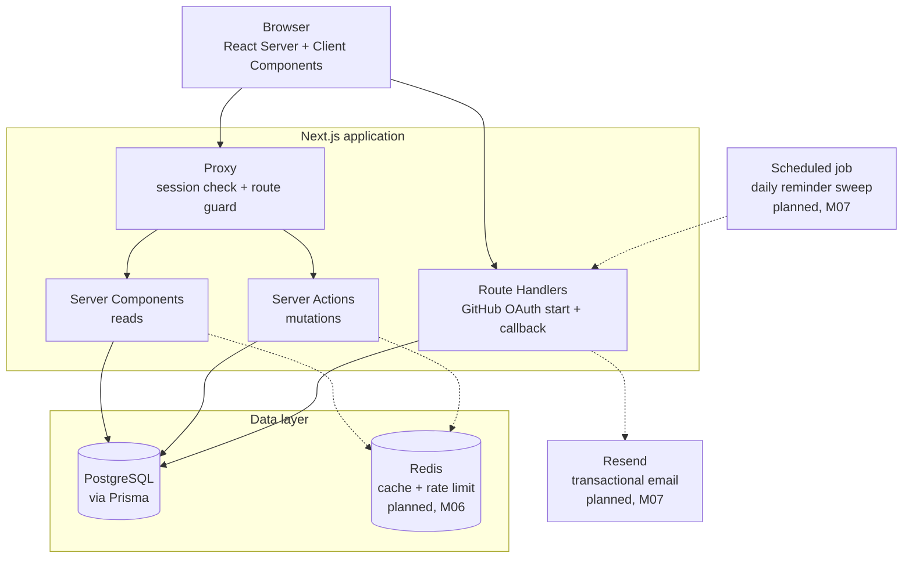
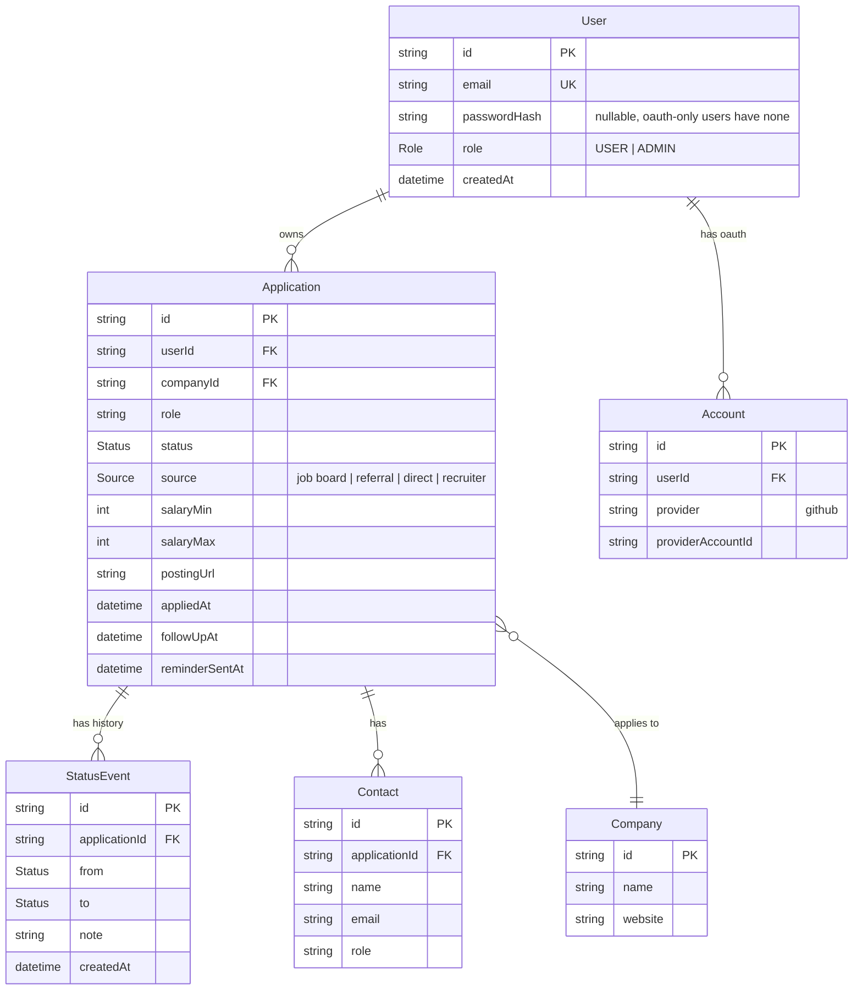

<div align="center">

# Job Application Tracker

**Track every application, its status, and follow-up reminders, so nothing slips through.**

[](https://nextjs.org)
[](https://www.typescriptlang.org)
[](https://www.postgresql.org)
[](https://www.prisma.io)
[](LICENSE)

</div>

---

## Build status

This project is built in public, one milestone at a time. The checklist is the honest picture of what actually runs today. Sections further down describe the product as designed, and every part that is not built yet says so in its heading or right next to it.

| # | Milestone | Status |
|---|---|---|
| 00 | Project setup, TypeScript, CI | [x] |
| 01 | Data model, PostgreSQL, Prisma | [x] |
| 02 | Credentials auth (JWT in httpOnly cookies) | [x] |
| 03 | OAuth sign-in (GitHub) | [x] |
| 04 | Application CRUD with validated forms | [x] |
| 05 | Status pipeline and event history | [x] |
| 06 | Redis rate limiting and caching | [ ] |
| 07 | Follow-up reminders via email | [ ] |
| 08 | Analytics dashboard | [ ] |
| 09 | Role-based access control | [ ] |
| 10 | Deployment and hardening | [~] |

[ ] planned | [~] in progress | [x] done

---

## Why this exists

I built this while job hunting myself.

Somewhere around the twentieth application the spreadsheet stopped working. Two companies had the same name in different rows, one interview date sat in a calendar the sheet knew nothing about, and a recruiter who had asked me to follow up "in about two weeks" got no reply for five. A spreadsheet stores data. It does not remind you of anything and it has no idea that "applied" and "waiting for feedback for 18 days" are different situations that need different reactions from you.

So the tracker is built around three things a spreadsheet cannot do. The first one runs today. It models an application as something that moves through states and remembers every move. The other two are next on the roadmap. It will watch the clock and email you before a follow-up goes stale (M07), and it will turn the whole pile into numbers, so you can see which channel actually produces interviews instead of guessing (M08).

---

## Features

### Application pipeline

Every application is a record with a company, a role, a source, a salary range, a link to the posting and free-form notes. It sits in exactly one status at a time and moves along a defined pipeline.

```
DRAFT -> APPLIED -> SCREENING -> INTERVIEW -> OFFER -> ACCEPTED
            |           |            |          |
            v           v            v          v
        REJECTED    REJECTED     REJECTED   DECLINED
```

`WITHDRAWN` is reachable from every status that is not final yet. `ACCEPTED`, `REJECTED`, `DECLINED` and `WITHDRAWN` are final, nothing leads out of them.

Transitions are not free. The server validates that the requested move is legal for the current status, so an application cannot jump from `DRAFT` straight to `OFFER` because a stale browser tab said so.

Every transition is written to an append-only `StatusEvent` table. That gives each application a timeline you can read back, and it makes questions like "how many days do I usually sit in screening" answerable with a query instead of a memory.

A Kanban board renders the pipeline as columns with drag-and-drop between them. The board is a view on the same data, not a second source of truth.

### Follow-up reminders (planned, M07)

The data model is ready for this. Each application carries an optional `followUpAt` date, and the dashboard already counts every application whose follow-up date has passed. What is missing is the sender.

A scheduled job will run daily, find everything that is due, and send one email per user summarizing what needs attention. The job is meant to be idempotent. A `reminderSentAt` timestamp per application, already in the schema, means a retry, a double-triggered cron or a redeploy mid-run cannot produce a second email for the same follow-up.

Emails will be transactional templates rendered with React Email and delivered through Resend.

### Analytics dashboard (planned, M08)

Today the dashboard shows three numbers, the application count, the applications whose follow-up date has passed and the account role. The planned version aggregates over the application and event tables and renders charts.

- Applications per week, stacked by current status
- Conversion funnel from applied through screening and interview to offer
- Response rate and median time to first response, broken down by source
- Average days spent in each pipeline stage
- Active applications that have gone quiet, ranked by days since the last event

These queries will be the heaviest read path in the app, so the computed result is planned to be cached in Redis (M06) and invalidated whenever a `StatusEvent` is written for that user.

### Accounts and access

Two ways in. Email and password with credentials hashed using Argon2id, and OAuth through GitHub. Both paths end in the same session, a signed JWT stored in an httpOnly, SameSite cookie.

The OAuth flow is written out rather than pulled from a library. It uses the authorization code flow with PKCE, a `state` cookie checked on the way back, the code exchanged server to server, and only email addresses that GitHub reports as **verified** are accepted. A GitHub sign-in is linked to an existing account with the same address only when that account has no password. Why is explained in the notes on the build. The code is written for GitHub only. A second provider would follow the same steps, but it needs its own module and routes, because the token exchange and the way to get a verified email differ per provider. One provider already shows the whole flow, which is why one is enough here.

Ownership is enforced server-side today. A user sees and edits only their own applications. Every read and every delete carries the user id in its `where` clause, and updates and status moves first load the row with that same scoped query and only write when it was found. Hiding a button in the UI is treated as cosmetics rather than as a security control.

Planned on top of that.

- **Roles (M09).** The `role` column exists and defaults to `USER`. An `ADMIN` operations view with aggregate platform metrics and no access to the content of anyone's applications is not built yet.
- **Rate limiting (M06).** Login and registration endpoints limited per IP and per account through a Redis sliding-window counter.

---

## Tech stack

| Layer | Choice | Why this one |
|---|---|---|
| Framework | Next.js 16, App Router | Server Components keep data fetching on the server, Server Actions remove the need for a separate REST layer for mutations |
| Language | TypeScript, strict mode | The pipeline is a state machine. The transition table is typed against the status union, so a status added to the enum without rules breaks the build, and every move is checked at runtime because the status arrives from the browser |
| Database | PostgreSQL 16 | Relational data with real foreign keys. Window functions are the planned tool for the funnel and time-in-stage queries (M08) |
| ORM | Prisma 7 | Typed queries generated from the schema, and versioned migrations so the schema history is reviewable in git. Uses the `pg` driver adapter rather than a bundled engine |
| Auth | jose, Argon2id | Signed JWT sessions without a session table, and the password hash recommended by OWASP |
| Validation | Zod | One schema parses every form payload on the server and infers the TypeScript type from the same definition. The forms show the field errors the server sends back |
| UI | Tailwind CSS 4, dnd-kit | Styles sit next to the markup and Prettier sorts the classes, dnd-kit handles drag and drop on the board |
| Testing | Vitest | Unit tests on the session handling and the transition rules |
| Cache & rate limiting | Redis 7 (planned, M06) | Sliding-window counters on auth endpoints and a TTL cache for dashboard aggregates. Both need fast expiring keys, which is exactly what Redis is for |
| Email | Resend + React Email (planned, M07) | Transactional delivery with templates written as components instead of hand-glued HTML strings |

End-to-end tests with Playwright are planned but not in the repo yet.

---

## Architecture

Solid lines run today. Dashed lines are planned.



Reads happen in Server Components and never reach the client as raw queries. Mutations on applications go through Server Actions, which are the single place where authorization, validation and the transition rules are enforced. The one write outside them is the GitHub callback, which creates or links the user. Route Handlers exist only for the cases that need a real HTTP endpoint. Today that is the GitHub OAuth start and callback, the cron trigger for reminders joins them in M07.

The proxy (Next.js 16 renamed middleware to proxy) is only the first check. The layout for signed-in pages checks the session again, most pages check it once more themselves, and every Server Action that touches applications checks it before it writes anything. A guard that gets skipped in one place is still enforced in the next.

---

## Data model



Two decisions worth calling out. `Company` is its own table rather than a string on the application, so every application for the same employer points at one row. Names are matched exactly for now, so "Acme" and "ACME" still become two companies, and normalizing them is still open. And `StatusEvent` is append-only. The code never updates or deletes a single event, which is what makes the timeline trustworthy and the time-in-stage analytics possible at all. Events only go away together with their application, through the cascade when the application or the account is deleted.

`Contact` is in the schema already, the UI for it is not built yet.

---

## Getting started

### Prerequisites

- Node.js 22 or newer
- Docker, for the local PostgreSQL container. Compose starts Redis as well, the app uses it from M06
- A [Resend](https://resend.com) API key, only needed once the reminder feature exists

### Setup

```bash
git clone https://github.com/aahmoh04/job-application-tracker-AM.git
cd job-application-tracker-AM

cp .env.example .env          # then set JWT_SECRET, at least 32 characters
npm install                   # postinstall runs prisma generate, which reads DATABASE_URL from .env

docker compose up -d          # starts postgres + redis
npx prisma migrate dev        # applies migrations

npm run dev                   # http://localhost:3000
```

### Environment variables

| Variable | Purpose |
|---|---|
| `DATABASE_URL` | PostgreSQL connection string |
| `JWT_SECRET` | Signing secret for session tokens, at least 32 characters |
| `NEXT_PUBLIC_APP_URL` | Public base URL, used for the OAuth callback. Email links will use it from M07 |
| `GITHUB_CLIENT_ID` / `GITHUB_CLIENT_SECRET` | GitHub OAuth credentials |
| `REDIS_URL` | Redis connection string, not used before M06 |
| `RESEND_API_KEY` | Transactional email delivery, not used before M07 |
| `CRON_SECRET` | Shared secret protecting the reminder endpoint, not used before M07 |

For GitHub sign-in, create an OAuth app at github.com/settings/developers with the callback `http://localhost:3000/api/auth/github/callback` and put its two keys into `.env`. Email and password sign-in works without it.

`npx prisma db seed` loads demo data, but it wipes every table first, so it belongs to a fresh database. The demo user `demo@example.com` has no password yet, so its data is only visible in Prisma Studio until M10 adds a demo account you can sign in to.

`.env` is gitignored. `.env.example` holds the keys and is committed. Prisma reads `.env` through `prisma.config.ts`, Next.js reads it as well.

### Scripts

| Command | What it does |
|---|---|
| `npm run dev` | Development server |
| `npm run build` | Production build |
| `npm run lint` | ESLint |
| `npm run typecheck` | Generates route types, then checks all types without emitting |
| `npm run format:check` | Prettier check, the same one CI runs |
| `npm run test` | Unit tests, Vitest |
| `npm run db:up` | Start the Postgres and Redis containers |
| `npm run db:stop` | Stop them again |
| `npm run db:migrate` | Create and apply a migration in development |
| `npm run db:seed` | Wipe the database and load demo data |
| `npm run db:studio` | Browse the database in the browser |

### Deploying

The production setup is Vercel for the app and a managed PostgreSQL such as Neon
for the data. Redis is not needed until the rate limiting in M06.

1. Create the database and copy its direct connection string, not the pooled
   one, because `prisma migrate deploy` runs against it. It needs
   `?sslmode=require` at the end, the `pg` driver then verifies the server
   certificate.
2. Register a second GitHub OAuth app for production. Its callback can be a
   placeholder for now. The local app keeps pointing at localhost.
3. Import the repository in Vercel and set five environment variables,
   `DATABASE_URL`, `JWT_SECRET`, `NEXT_PUBLIC_APP_URL`, `GITHUB_CLIENT_ID` and
   `GITHUB_CLIENT_SECRET`. `NEXT_PUBLIC_APP_URL` is the public address without a
   trailing slash. The other variables in the table are not needed yet.
4. After the first build, put the real address into the OAuth app as
   `https://<your-domain>/api/auth/github/callback` and into
   `NEXT_PUBLIC_APP_URL`, then redeploy.

`vercel.json` runs `prisma migrate deploy` before `next build`, so every
deployment carries its own schema changes to the database first. A deployment
whose migration fails never goes live.

`next.config.ts` adds a small set of security headers to every response. They
are listed and explained in that file.

---

## Project structure

```
src/
  app/
    page.tsx              landing page
    (auth)/               sign-in and sign-up pages, form actions, OAuth buttons
    (app)/                everything behind a session, the layout checks it again
      dashboard/          counts and shortcuts, charts arrive in M08
      applications/       list, detail, create, edit
        board/            Kanban board with drag and drop
    api/auth/github/      OAuth start, callback/ handles the way back
  components/             status badge, delete button
  generated/prisma/       Prisma client, generated and gitignored
  lib/
    auth/                 sessions, Argon2id hashing, cookies, GitHub OAuth
    applications/         queries and Server Actions, ownership in every where clause
    pipeline/             transition rules, the state machine
    validation/           Zod schemas, parsed in the Server Actions
    db.ts                 Prisma client singleton
  proxy.ts                route guard, the Next.js 16 name for middleware
prisma/
  schema.prisma
  migrations/
  seed.ts
```

Tests sit next to the code they test, as `*.test.ts`.

---

## Roadmap

Shipping order, one milestone at a time. The numbers match the status table above.

- **M00 Foundation.** Next.js with strict TypeScript, ESLint, Prettier, GitHub Actions running format check, lint, typecheck, tests and build on every push to main and every pull request
- **M01 Data model.** Prisma schema, first migration, seed script, Docker Compose for Postgres and Redis
- **M02 Credentials auth.** Registration, Argon2id hashing, JWT session in an httpOnly cookie, route guard in the proxy
- **M03 OAuth.** GitHub sign-in, authorization code flow with PKCE, linking by verified email onto accounts that have no password
- **M04 Applications.** Create, read, update, delete, Zod validation in the Server Actions, ownership enforced in the query itself rather than checked afterwards
- **M05 Pipeline.** Transition rules as a typed state machine, StatusEvent history, Kanban board with drag and drop
- **M06 Redis.** Sliding-window rate limiter on auth, cached dashboard aggregates with event-driven invalidation
- **M07 Reminders.** Daily cron sweep, idempotent sending, React Email templates through Resend
- **M08 Analytics.** Funnel, response rate by source, time in stage, quiet-application ranking
- **M09 RBAC.** Admin role, operations view, server-side enforcement on every mutation
- **M10 Ship.** Deploy to Vercel with a managed Postgres, seed a demo account, add screenshots here. Done so far are migrations inside the build and the security headers. Redis joins once M06 needs it

### Later, if the core holds up

- Paste a job posting and have an LLM extract company, role, requirements and deadline into a prefilled form
- Browser extension that captures an application from the posting page in one click
- CSV and JSON export, plus import from a spreadsheet for people migrating off one
- iCal feed so interviews land in a real calendar

---

## Notes on the build

Things worth writing down as I go, filled in milestone by milestone.

- **Why ownership lives in the `where` clause and not in an `if`.** Every read takes a user id and puts it into the query, so an application belonging to someone else is never loaded rather than loaded and rejected. Deleting uses `deleteMany` with the same where clause. `delete` would accept the user id as well, but it throws when nothing matches, while `deleteMany` simply affects zero rows, so a foreign id gets exactly the same answer as a missing one
- **Why M03 ships with one OAuth provider instead of two.** The plan said Google and GitHub. GitHub is done, and adding Google would have meant a second set of credentials on top of a flow that is already written and understood. The interesting part of OAuth is the flow itself, not repeating it, so the scope was cut on purpose rather than left half finished
- **Why GitHub sign-in never links onto a password account.** GitHub confirms that an address is verified, sign-up here does not, because it sends no confirmation mail. A password account therefore proves nothing about who owns its address, and anyone could register a stranger's address first. Linking GitHub onto such an account by email would put the real owner into an account whose password someone else knows. So GitHub only links onto accounts without a password, which only GitHub sign-in creates, and everyone else signs in with their password. Removing the password while linking would not have helped, because sessions are signed JWTs without a session table, and a session that is already open stays valid until it expires. Confirming addresses at sign-up would make linking safe again, and the mail setup for that comes with M07
- **Why the pipeline lives in one module.** Every legal move is listed exactly once, in `src/lib/pipeline/transitions.ts`. The edit form, the status buttons on the detail page and the Kanban board all ask that module which moves to offer, and the Server Actions ask it again before anything is written, because a status posted by a browser is just a string until the server has checked it. The table is typed with `satisfies Record<Status, readonly Status[]>`, so adding a status to the Prisma enum without deciding where it may go breaks the build. Spreading the rules across the UI would have meant three places that can disagree, and the board would have been the first to drift

Still to write, once the milestone lands.

- What actually changed when the dashboard queries moved behind a cache (M06)
- How `reminderSentAt` keeps a retried reminder job from sending the same email twice (M07)

---

## License

MIT. See [LICENSE](LICENSE).

<div align="center">

Built by [**@aahmoh04**](https://github.com/aahmoh04)

</div>
