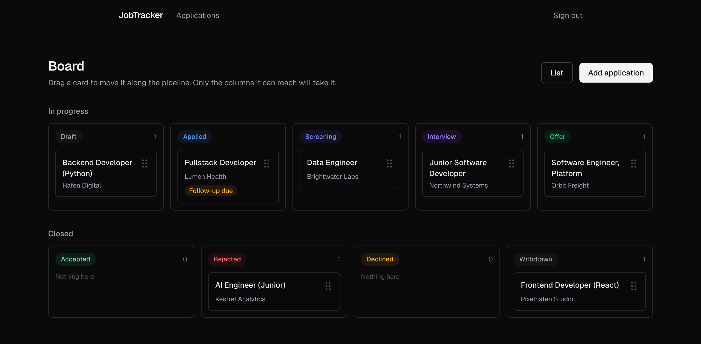
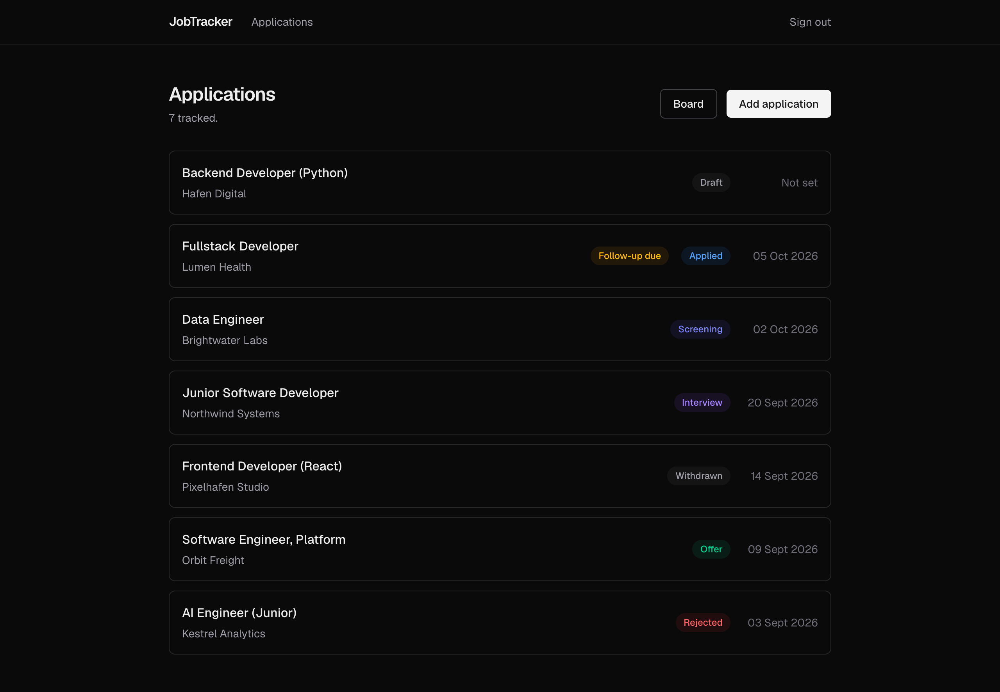
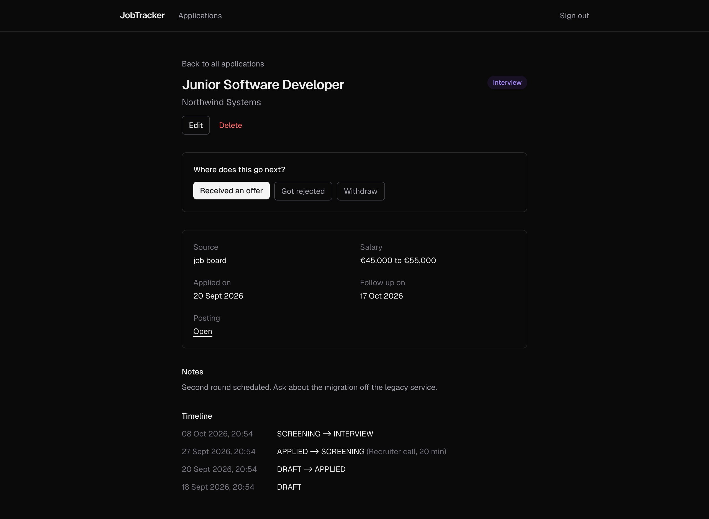
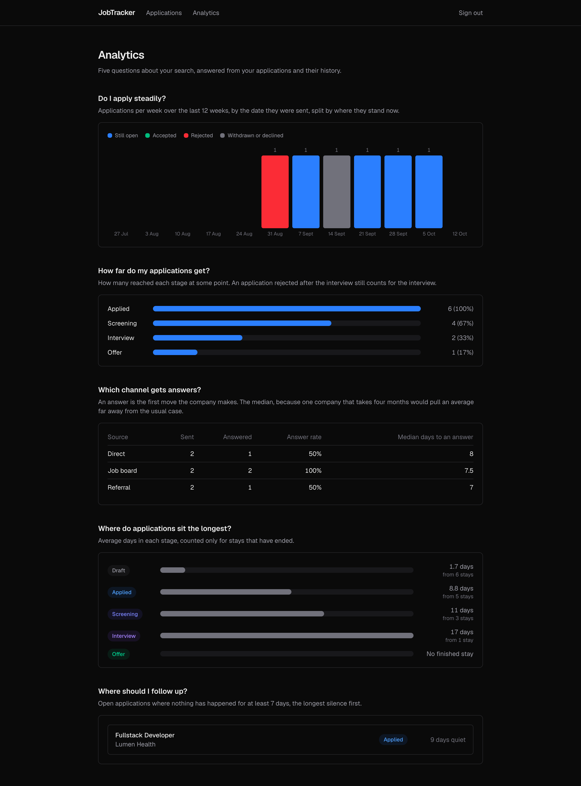
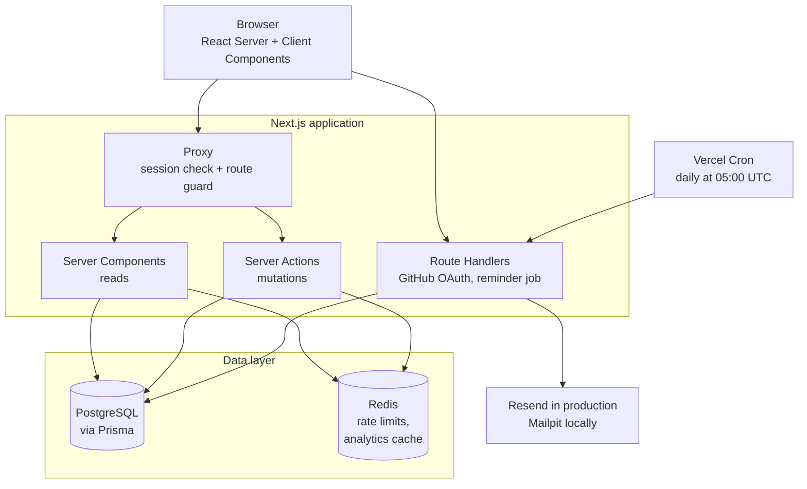
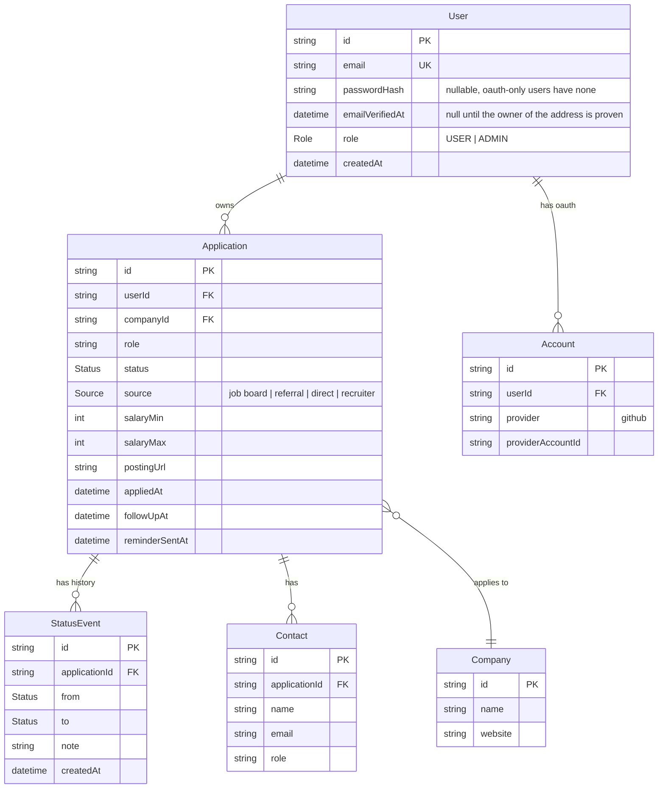

<div align="center">

# Job Application Tracker

**Track every application, its status, and follow-up reminders, so nothing slips through.**

[](https://nextjs.org)
[](https://www.typescriptlang.org)
[](https://www.postgresql.org)
[](https://www.prisma.io)
[](LICENSE)

</div>

There is no hosted instance, on purpose. The app stores email addresses, and running it in public would make me responsible for strangers' data. Everything below is written so you can see what it does and get your own copy running, [locally in a few minutes](#getting-started) with a demo account, or [on Vercel](#deploying-your-own-copy) if you want it online.



<p>
  
  
</p>

<sub>The demo data from the seed. Left the list with a due follow-up, right one application with its next steps and timeline.</sub>

---

## Build status

This project is built in public, one milestone at a time. The checklist is the honest picture of what actually runs today. Sections further down describe the product as designed, and every part that is not built yet says so in its heading or right next to it.

| # | Milestone | Status |
|---|---|---|
| 00 | Project setup, TypeScript, CI | [x] |
| 01 | Data model, PostgreSQL, Prisma | [x] |
| 02 | Credentials auth (JWT in httpOnly cookies) | [x] |
| 03 | OAuth sign-in (GitHub) | [x] |
| 04 | Application CRUD with validated forms | [x] |
| 05 | Status pipeline and event history | [x] |
| 06 | Redis rate limiting and caching | [x] |
| 07 | Follow-up reminders via email | [x] |
| 08 | Analytics dashboard | [x] |
| 09 | Role-based access control | [x] |
| 10 | Deployment setup and hardening | [x] |

[ ] planned | [~] in progress | [x] done

---

## Why this exists

I built this while job hunting myself.

Somewhere around the twentieth application the spreadsheet stopped working. Two companies had the same name in different rows, one interview date sat in a calendar the sheet knew nothing about, and a recruiter who had asked me to follow up "in about two weeks" got no reply for five. A spreadsheet stores data. It does not remind you of anything and it has no idea that "applied" and "waiting for feedback for 18 days" are different situations that need different reactions from you.

So the tracker is built around three things a spreadsheet cannot do, and all three run today. It models an application as something that moves through states and remembers every move. It turns the whole pile into numbers, so you can see which channel actually produces interviews instead of guessing. And it watches the clock and mails you when a follow-up comes due.

---

## Features

### Application pipeline

Every application is a record with a company, a role, a source, a salary range, a link to the posting and free-form notes. It sits in exactly one status at a time and moves along a defined pipeline.

```
DRAFT -> APPLIED -> SCREENING -> INTERVIEW -> OFFER -> ACCEPTED
            |           |            |          |
            v           v            v          v
        REJECTED    REJECTED     REJECTED   DECLINED
```

`WITHDRAWN` is reachable from every status that is not final yet. `ACCEPTED`, `REJECTED`, `DECLINED` and `WITHDRAWN` are final, nothing leads out of them.

Transitions are not free. The server validates that the requested move is legal for the current status, so an application cannot jump from `DRAFT` straight to `OFFER` because a stale browser tab said so. The write itself only matches while the status is still the one that was checked, so two tabs moving the same application at the same moment cannot both get through.

Every transition is written to an append-only `StatusEvent` table. That gives each application a timeline you can read back, and it makes questions like "how many days do I usually sit in screening" answerable with a query instead of a memory.

A Kanban board renders the pipeline as columns with drag-and-drop between them. The board is a view on the same data, not a second source of truth.

### Follow-up reminders

Every application can carry a follow-up date, the day you want to ask how things stand. The dashboard counts the ones that are due, and every morning a job sends each user one mail that lists them, with a link to each application. Setting the date is the opt-in. Without one, no mail.

The job is idempotent. It claims a user's due follow-ups in one `UPDATE` that only matches rows whose `reminderSentAt` is still empty, and only then sends the mail. A second run finds nothing left to claim, whether it comes a minute later or at the same moment, so a retry, a double-triggered cron or a redeploy mid-run cannot produce a second mail. A failed send gives the claim back for the next run, and a new follow-up date makes the application due for a new reminder.

Mail only goes to addresses someone has proven to own. GitHub proves it for the accounts it creates, and sign-up cannot confirm an address yet, so password accounts get reminders once it can. The job is a Route Handler at `/api/cron/reminders`, triggered by Vercel Cron every day at 05:00 UTC and protected by `CRON_SECRET`. Locally every mail lands in Mailpit, a test inbox at `http://localhost:8025`. In production it goes out through Resend.

### Analytics dashboard

`/analytics` answers five questions about a search, each one from the user's own applications and their status history.

- **Do I apply steadily?** Applications per week over the last twelve weeks, by the date they were sent, split into still open, accepted, rejected, and withdrawn or declined
- **How far do my applications get?** A funnel from applied through screening and interview to offer, counted from the history, so an application rejected after the interview still counts for the interview
- **Which channel gets answers?** Answer rate and the median days to the first answer, per source. The median, because one company that answers after four months would pull an average far away from the usual case
- **Where do applications sit the longest?** Average days per stage, from consecutive status events with a `LAG` window function. Only stays that have ended count
- **Where should I follow up?** Open applications without any event for at least a week, the longest silence first



All five are computed in Postgres with `$queryRaw`, because window functions, percentiles and `FILTER` are beyond Prisma's query API, and every value still goes in as a parameter. Integration tests run them against a real Postgres, see [Getting started](#getting-started). They are the heaviest read path in the app, so the page reads them through a per-user cache in Redis. Every write to an application invalidates it, an edited source or a deletion as much as a status move, and entries expire after five minutes, because two of the answers depend on the clock. Why the cache works with versioned keys instead of deleting entries is in the notes on the build.

### Accounts and access

Two ways in. Email and password with credentials hashed using Argon2id, and OAuth through GitHub. Both paths end in the same session, a signed JWT stored in an httpOnly, SameSite cookie.

The OAuth flow is written out rather than pulled from a library. It uses the authorization code flow with PKCE, a `state` cookie checked on the way back, the code exchanged server to server, and only email addresses that GitHub reports as **verified** are accepted. A GitHub sign-in is linked to an existing account with the same address only when that account has no password. Why is explained in the notes on the build. The code is written for GitHub only. A second provider would follow the same steps, but it needs its own module and routes, because the token exchange and the way to get a verified email differ per provider. One provider already shows the whole flow, which is why one is enough here.

Sign-in and sign-up are rate limited in Redis, with a sliding window kept in a sorted set and updated by one Lua script. Five wrong passwords lock an account for fifteen minutes, counted for addresses that do not exist as well, so a lock reveals nothing. Twenty attempts from one network address within fifteen minutes stop that address. Sign-up allows five new accounts per address and hour, and a taken email counts too, so sign-up cannot be used to test addresses quickly either. Redis only ever sees SHA-256 digests of the emails and addresses it counts.

Who is making a request is decided in one place. The session token only proves an identity, and `requireUser()` loads the account from the database on every request. A deleted account is signed out at once, and a changed role takes effect with the next click instead of when the week-long token runs out. Every signed-in page and every Server Action goes through that guard, and a test finds every page by its file name, so a page added later without the guard fails CI.

Ownership is enforced server-side today. A user sees and edits only their own applications. Every read and every delete carries the user id in its `where` clause, and updates and status moves first load the row with that same scoped query and only write when it was found. Hiding a button in the UI is treated as cosmetics rather than as a security control.

The role decides one thing. An account with the `ADMIN` role gets a page at `/admin` with numbers about the platform. How many accounts there are, how many joined or were active lately, how they sign in, and how many applications sit in each status. It shows no application, email or company name of any account, and the role is no key to anyone's applications either, every query for them keeps its user id for admins as well. Everyone else gets the same 404 as for a page that does not exist. Roles are given with `npm run user:role`, the app itself has no page or action that changes one.

---

## Tech stack

| Layer | Choice | Why this one |
|---|---|---|
| Framework | Next.js 16, App Router | Server Components keep data fetching on the server, Server Actions remove the need for a separate REST layer for mutations |
| Language | TypeScript, strict mode | The pipeline is a state machine. The transition table is typed against the status union, so a status added to the enum without rules breaks the build, and every move is checked at runtime because the status arrives from the browser |
| Database | PostgreSQL 16 | Relational data with real foreign keys. Window functions and percentiles carry the analytics, `LAG` for the time in each stage and `percentile_cont` for the median response time |
| ORM | Prisma 7 | Typed queries generated from the schema, and versioned migrations so the schema history is reviewable in git. Uses the `pg` driver adapter rather than a bundled engine |
| Auth | jose, Argon2id | Signed JWT sessions without a session table, and the password hash recommended by OWASP. The token proves who someone is, the database decides what they may do |
| Validation | Zod | One schema parses every form payload on the server and infers the TypeScript type from the same definition. The forms show the field errors the server sends back |
| UI | Tailwind CSS 4, dnd-kit | Styles sit next to the markup and Prettier sorts the classes, dnd-kit handles drag and drop on the board |
| Testing | Vitest | Unit tests on the pure logic, and integration tests against a real Postgres and Redis for the analytics SQL and its cache, the rate limits, sign-up, sign-in, the GitHub callback and the ownership of every application, locally in Docker and in CI as service containers |
| Cache & rate limiting | Redis 7 | Sliding-window rate limits on sign-in and sign-up, and a per-user cache for the analytics with versioned keys. Both need fast keys that expire by themselves, which is exactly what Redis is for |
| Email | Resend in production, Mailpit locally | Both are reached with a single fetch against their HTTP API, the way the GitHub sign-in works without an SDK. Mailpit catches every mail in a local test inbox, so development needs no account and sends nothing real |

End-to-end tests with Playwright are planned but not in the repo yet.

---

## Architecture

Everything in the diagram runs today.



Reads happen in Server Components and never reach the client as raw queries. Mutations on applications go through Server Actions, which are the single place where authorization, validation and the transition rules are enforced. The one write outside them is the GitHub callback, which creates or links the user. Route Handlers exist only for the cases that need a real HTTP endpoint. That is the GitHub OAuth start and callback, the route that ends the session of a deleted account, and the trigger for the reminder job.

The proxy (Next.js 16 renamed middleware to proxy) is only the first check. The layout for signed-in pages checks again, every page checks once more itself, and every Server Action that touches applications checks before it writes anything. All of them use the same guard, which also asks the database whether the account still exists. A guard that gets skipped in one place is still enforced in the next.

---

## Data model



Two decisions worth calling out. `Company` is its own table rather than a string on the application, so every application for the same employer points at one row. Names are matched exactly for now, so "Acme" and "ACME" still become two companies, and normalizing them is still open. And `StatusEvent` is append-only. The code never updates or deletes a single event, which is what makes the timeline trustworthy and the time-in-stage analytics possible at all. Events only go away together with their application, through the cascade when the application or the account is deleted.

`Contact` is in the schema already, the UI for it is not built yet.

---

## Getting started

### Prerequisites

- Node.js 22 or newer
- Docker, for the local PostgreSQL container. Compose starts Redis as well, which the rate limits and the analytics cache use, and Mailpit, which catches the reminder mails

That is all. Running it locally needs no account anywhere, and GitHub sign-in is optional.

### Setup

```bash
git clone https://github.com/aahmoh04/job-application-tracker-AM.git
cd job-application-tracker-AM

cp .env.example .env          # then set JWT_SECRET, see below
npm install                   # postinstall runs prisma generate, which reads DATABASE_URL from .env

docker compose up -d          # starts postgres, redis and mailpit
npx prisma migrate dev        # applies migrations
npx prisma db seed            # demo data and a demo account

npm run dev                   # http://localhost:3000
```

`JWT_SECRET` needs at least 32 characters, and `openssl rand -base64 48` prints one that is long enough.

Then sign in as `demo@example.com` with the password `demo-password-123`. The demo account comes with seven applications spread across the pipeline, so the list, the board and the timelines have something to show. The seed wipes every table before it writes, so run it on a fresh database and never on one whose data you want to keep.

To see the admin page as well, give the demo account the role with `npm run user:role -- demo@example.com ADMIN`. It applies with the next click, without signing in again.

To see a reminder mail, put any long random string into `CRON_SECRET` in `.env`, restart the dev server and trigger the job by hand. The demo data has one overdue follow-up, and the mail shows up in Mailpit at http://localhost:8025.

```bash
curl -H "Authorization: Bearer <your CRON_SECRET>" http://localhost:3000/api/cron/reminders
```

### Environment variables

| Variable | Purpose |
|---|---|
| `DATABASE_URL` | PostgreSQL connection string |
| `JWT_SECRET` | Signing secret for session tokens, at least 32 characters |
| `NEXT_PUBLIC_APP_URL` | Public base URL, used for the OAuth callback and the links in reminder mails |
| `GITHUB_CLIENT_ID` / `GITHUB_CLIENT_SECRET` | GitHub OAuth credentials |
| `REDIS_URL` | Redis for the rate limits and the analytics cache. Without it the limits switch themselves off and the analytics are read straight from Postgres |
| `MAIL_FROM` | Sender address of the reminder mails |
| `MAILPIT_URL` | The local test inbox from `docker-compose.yml`, used while `RESEND_API_KEY` is empty |
| `RESEND_API_KEY` | Sends the reminder mails through Resend. Leave it empty locally, then they go to Mailpit |
| `CRON_SECRET` | Protects the reminder job. Vercel Cron sends it as a bearer token, and without it the job refuses to run |

For GitHub sign-in, create an OAuth app at github.com/settings/developers with the callback `http://localhost:3000/api/auth/github/callback` and put its two keys into `.env`. Email and password sign-in works without it.

`.env` is gitignored. `.env.example` holds the keys and is committed. Prisma reads `.env` through `prisma.config.ts`, Next.js reads it as well.

### Scripts

| Command | What it does |
|---|---|
| `npm run dev` | Development server |
| `npm run build` | Production build |
| `npm run lint` | ESLint |
| `npm run typecheck` | Generates route types, then checks all types without emitting |
| `npm run format:check` | Prettier check, the same one CI runs |
| `npm run test` | Unit tests, Vitest, no database needed |
| `npm run test:integration` | Integration tests against Postgres and Redis, needs the Docker containers. Creates the `jobtracker_test` database on first use and refuses any database whose name does not end in `_test`, and uses Redis database 15 only, because every test empties what it uses |
| `npm run db:up` | Start the Postgres, Redis and Mailpit containers |
| `npm run db:stop` | Stop them again |
| `npm run db:migrate` | Create and apply a migration in development |
| `npm run db:seed` | Wipe the database and load demo data |
| `npm run db:studio` | Browse the database in the browser |
| `npm run user:role -- <email> <ADMIN\|USER>` | Give an account a role. The only way a role changes |

### Deploying your own copy

There is no hosted instance, but nothing stops you from running one. It takes
a PostgreSQL database, where the free plan at Neon is enough, a Vercel account
on the free Hobby plan, and a second GitHub OAuth app if GitHub sign-in should
work there too. Redis is optional. Without `REDIS_URL` the rate limits switch
themselves off and the analytics skip the cache, so a deployment that wants
both needs a managed Redis as well.

1. Create the database in Frankfurt, `aws-eu-central-1` on Neon, which is where
   `vercel.json` runs the functions. Copy its direct connection string, not the
   pooled one, because `prisma migrate deploy` runs against it. End it with
   `?sslmode=verify-full`, so the `pg` driver checks the server certificate
   and its host name. Neon hands out the string with `sslmode=require`, which
   the driver treats the same way today, but its next major version switches
   to the weaker libpq meaning that skips the certificate check.
2. Register a second GitHub OAuth app for production. Its callback can be a
   placeholder for now. The local app keeps pointing at localhost.
3. Import the repository in Vercel and set five environment variables for the
   Production environment only, `DATABASE_URL`, `JWT_SECRET`,
   `NEXT_PUBLIC_APP_URL`, `GITHUB_CLIENT_ID` and
   `GITHUB_CLIENT_SECRET`. `NEXT_PUBLIC_APP_URL` is the public address without a
   trailing slash. For reminder mails add `CRON_SECRET`, `MAIL_FROM` and
   `RESEND_API_KEY`, the last one from a Resend account with a verified sending
   domain. Without them everything works except the reminders.
4. After the first build, put the real address into the OAuth app as
   `https://<your-domain>/api/auth/github/callback` and into
   `NEXT_PUBLIC_APP_URL`, then redeploy.
5. For the admin page, sign up once and then run `npm run user:role` on your
   machine with the production `DATABASE_URL` set for that one command.

`vercel.json` runs `prisma migrate deploy` before `next build`, so every
deployment carries its own schema changes to the database first. A deployment
whose migration fails never goes live.

It also pins the functions to Frankfurt (`fra1`), next to the database. Every
page runs several queries, and from the default region in the US each one
would cross the Atlantic. Preview deployments are skipped through
`ignoreCommand`. There is only one database, so a preview build would run the
migrations of an unmerged pull request against production. Keeping the
variables out of the Preview environment is the second lock on the same door.

Finally it schedules the reminder job. Vercel calls `/api/cron/reminders` every
day at 05:00 UTC, which is 06:00 or 07:00 in Germany, and sends `CRON_SECRET`
along. The Hobby plan allows one run a day, and a daily reminder needs no more.

`next.config.ts` adds a small set of security headers to every response. They
are listed and explained in that file.

---

## Project structure

```
src/
  app/
    page.tsx              landing page
    (auth)/               sign-in and sign-up pages, form actions, OAuth buttons
    (app)/                everything behind a session, the layout checks it again
      admin/              platform numbers for admins, no content of any account
      dashboard/          counts and shortcuts
      analytics/          five questions about the search, answered in SQL
      applications/       list, detail, create, edit
        board/            Kanban board with drag and drop
    api/auth/
      github/             OAuth start, callback/ handles the way back
      session-ended/      clears the cookie of an account that no longer exists
    api/cron/reminders/   the daily reminder job, protected by CRON_SECRET
  components/             status badge, delete button
  generated/prisma/       Prisma client, generated and gitignored
  lib/
    admin/                the numbers behind the admin page, and the one place roles change
    auth/                 the guard, sessions, Argon2id hashing, cookies, redirects, GitHub OAuth
    applications/         queries, Server Actions, the follow-up rule, ownership in every where clause
    analytics/            the SQL behind the analytics page, cached per user, with integration tests
    mail/                 sends a mail through Mailpit locally or Resend in production
    pipeline/             transition rules, the state machine
    reminders/            the reminder job and the mail it sends
    validation/           Zod schemas, parsed in the Server Actions
    cache.ts              per-user cache in Redis with versioned keys
    db.ts                 Prisma client singleton
    format.ts             date formats with an explicit time zone
    rate-limit.ts         sliding-window limits for sign-in and sign-up
    redis.ts              one Redis connection per process
    request.ts            the client address the rate limits count
  test/                   database, Redis and Mailpit helpers, and the global setup for the integration tests
  proxy.ts                route guard, the Next.js 16 name for middleware
prisma/
  schema.prisma
  migrations/
  seed.ts
scripts/
  set-role.ts             gives an account a role, run as npm run user:role
```

Tests sit next to the code they test, as `*.test.ts`. The ones that need a database end in `.int.test.ts`, and their helpers live in `src/test/`.

---

## Roadmap

Shipping order, one milestone at a time. The numbers match the status table above.

- **M00 Foundation.** Next.js with strict TypeScript, ESLint, Prettier, GitHub Actions running format check, lint, typecheck, unit tests, integration tests against Postgres and Redis service containers and the build on every push to main and every pull request, plus Dependabot for weekly dependency updates
- **M01 Data model.** Prisma schema, first migration, seed script, Docker Compose for Postgres and Redis
- **M02 Credentials auth.** Registration, Argon2id hashing, JWT session in an httpOnly cookie, route guard in the proxy
- **M03 OAuth.** GitHub sign-in, authorization code flow with PKCE, linking by verified email onto accounts that have no password
- **M04 Applications.** Create, read, update, delete, Zod validation in the Server Actions, ownership enforced in the query itself rather than checked afterwards
- **M05 Pipeline.** Transition rules as a typed state machine, StatusEvent history, Kanban board with drag and drop
- **M06 Redis.** Sliding-window rate limits on sign-in and sign-up, and the analytics behind a per-user cache with versioned keys, invalidated by every write
- **M07 Reminders.** A daily cron trigger, one summary mail per user, claimed before sending so it goes out at most once, only to confirmed addresses, through Mailpit locally and Resend in production
- **M08 Analytics.** Five questions answered in SQL, weekly volume, a funnel from the status history, answer rate and median response time by source, time in stage with `LAG`, quiet applications. Integration tests against Postgres, locally and in CI
- **M09 RBAC.** One guard for every page and Server Action that reads the account fresh from the database, and an admin page with platform numbers that shows no account's content. Roles change only through a script
- **M10 Ship.** Everything a deployment needs, without running a public instance. Migrations inside the build, security headers, functions pinned next to the database, preview builds kept away from production, a demo account in the seed and screenshots in this README. Redis stays optional, without it the rate limits and the cache step aside

### Later, if the core holds up

- Paste a job posting and have an LLM extract company, role, requirements and deadline into a prefilled form
- Browser extension that captures an application from the posting page in one click
- CSV and JSON export, plus import from a spreadsheet for people migrating off one
- iCal feed so interviews land in a real calendar

---

## Notes on the build

Things worth writing down as I go, filled in milestone by milestone.

- **Why ownership lives in the `where` clause and not in an `if`.** Every read takes a user id and puts it into the query, so an application belonging to someone else is never loaded rather than loaded and rejected. Deleting uses `deleteMany` with the same where clause. `delete` would accept the user id as well, but it throws when nothing matches, while `deleteMany` simply affects zero rows, so a foreign id gets exactly the same answer as a missing one
- **Why M03 ships with one OAuth provider instead of two.** The plan said Google and GitHub. GitHub is done, and adding Google would have meant a second set of credentials on top of a flow that is already written and understood. The interesting part of OAuth is the flow itself, not repeating it, so the scope was cut on purpose rather than left half finished
- **Why GitHub sign-in never links onto a password account.** GitHub confirms that an address is verified, sign-up here does not, because it sends no confirmation mail. A password account therefore proves nothing about who owns its address, and anyone could register a stranger's address first. Linking GitHub onto such an account by email would put the real owner into an account whose password someone else knows. So GitHub only links onto accounts without a password, which only GitHub sign-in creates, and everyone else signs in with their password. Removing the password while linking would not have helped, because sessions are signed JWTs without a session table, and a session that is already open stays valid until it expires. Confirming addresses at sign-up would make linking safe again. The mail setup for that arrived with M07, the confirmation itself comes next
- **Why the rate limits count addresses that do not exist, and let requests through when Redis is down.** A lock that only ever hit real accounts would tell an attacker which addresses are registered, the same leak the uniform error message avoids, so failed sign-ins count for any address. Being locked out of every login whenever Redis has a bad minute would be an outage of its own, so a missing or silent Redis lets the request through, and the cost of Argon2id still keeps each guess slow. The client never queues a command while it is disconnected and gives every command half a second, so a broken Redis cannot make a sign-in hang either
- **What changed when the analytics moved behind a cache.** Less than the word suggests, and that is the honest part. With a few dozen applications the five queries take milliseconds, so nobody would notice the cache. It is here to build the pattern once, and its hard part is invalidation, not storage. Every user has a version number in Redis, and each cached answer carries the version it was computed under in its key. A write bumps the version once it has committed, which makes every older answer unreachable at once. Deleting the entry instead would leave a gap. A page view that read the old data just before the write could store its result right after the delete, and the old numbers would be back until they expire. With versions that late result lands under the old number, where nobody looks. Bumping before the commit would open the same gap from the other side. Both moments are held open in tests, and each test fails as soon as its rule is taken out. The plan said to invalidate when a `StatusEvent` is written, but the source, the date sent and the role feed the numbers too, so every save and every deletion invalidates. Entries still expire after five minutes, because two answers depend on the clock and because an invalidation lost to a Redis hiccup should not leave wrong numbers behind for long. Without Redis the page reads straight from Postgres
- **How the security rules are tested.** The rules that keep data safe run as integration tests against Postgres. A stranger's application cannot be edited, deleted or moved, GitHub never links onto an account with a password, a wrong password and an unknown address get the same answer, and `next` cannot lead off the site. Each of these tests was checked by deleting the rule it guards and watching exactly that test fail. The race between two tabs needed more than that. Two requests in a test rarely overlap, because the second one is still opening its connection when the first has finished, so a test that simply fires both passes even without the guard. A third connection now locks the row, both requests read the same status and queue up behind the lock, and only then is it released. With the status in the `where` clause one write wins every time, without it both get through every time
- **Why the token carries no role, and what happens to a deleted account.** The session is a signed JWT that stays valid for a week, and whatever is written into it stays true for that week. A role in the token would let a demoted admin keep the role until it runs out. So the token only says who someone is, and `requireUser()` in `src/lib/auth/guard.ts` reads the account and its role from the database on every request. That is one lookup by primary key, and React's `cache()` lets the layout, the page and `generateMetadata` share it. The same lookup notices a deleted account, which used to end in a loop. The dashboard sent a session without an account to the sign-in page, and the proxy, which only checks the signature, sent the still valid token straight back to the dashboard. Pages cannot change cookies, so the guard now sends such a session to a small Route Handler that clears the cookie, and only when the account is really gone, so a link to it cannot sign anyone out. Tests cover every action and every page, the pages found by file name, and each test fails as soon as its guard is replaced by a check of the token alone
- **Why an admin sees numbers and not applications, and why roles come from a script.** Least privilege. Running a platform takes knowing how it is used, not reading anyone's job search, so the admin page only gets counts and statuses, and the type it receives has no field that could carry an email or a company. A test plants such content and fails if any of it reaches the page. The role opens the admin page and nothing else. Every query for applications keeps its user id for admins too, and the tests for a stranger's application run once as a user and once as an admin. Roles change only through `npm run user:role`, because a role that the app can write is a role that a bug in the app can hand out. A list of admin emails in an environment variable was the other option, but sign-up does not confirm addresses yet, so anyone could register such an address first. One honest limit remains. With three accounts the counts are not anonymous, a single GitHub account is a person. A platform with real users would hide small numbers, this one does not yet
- **Why the pipeline lives in one module.** Every legal move is listed exactly once, in `src/lib/pipeline/transitions.ts`. The edit form, the status buttons on the detail page and the Kanban board all ask that module which moves to offer, and the Server Actions ask it again before anything is written, because a status posted by a browser is just a string until the server has checked it. The table is typed with `satisfies Record<Status, readonly Status[]>`, so adding a status to the Prisma enum without deciding where it may go breaks the build. Spreading the rules across the UI would have meant three places that can disagree, and the board would have been the first to drift
- **How `reminderSentAt` keeps the reminder job from sending a mail twice.** The job claims a user's due follow-ups in one `UPDATE` that only matches rows whose `reminderSentAt` is still empty, and sends the mail only after that. A second run finds nothing left, whether it comes a minute later or at the same moment, because Postgres makes the second of two simultaneous updates wait for the first and then checks the condition again. Two tests prove it. One runs the job twice in a row. The other holds the first run in the middle of sending while a second run starts. Sending first and marking after passes the first test and fails the second, which is why the second one exists. The price is that a reminder goes out at most once. A failed send gives the claim back for the next run, and only a crash in the moment between claim and send loses one. Mail only goes to confirmed addresses, which today means accounts created through GitHub, and the template is a function rather than a React component, because `react-dom/server` refuses to load in the server layer that Route Handlers run in. Building it surfaced an older bug. An emptied field in the edit form arrived as `undefined`, which Prisma reads as "leave it alone", so a cleared follow-up date, note, link or salary kept its old value

---

## License

MIT. See [LICENSE](LICENSE).

<div align="center">

Built by [**@aahmoh04**](https://github.com/aahmoh04)

</div>
